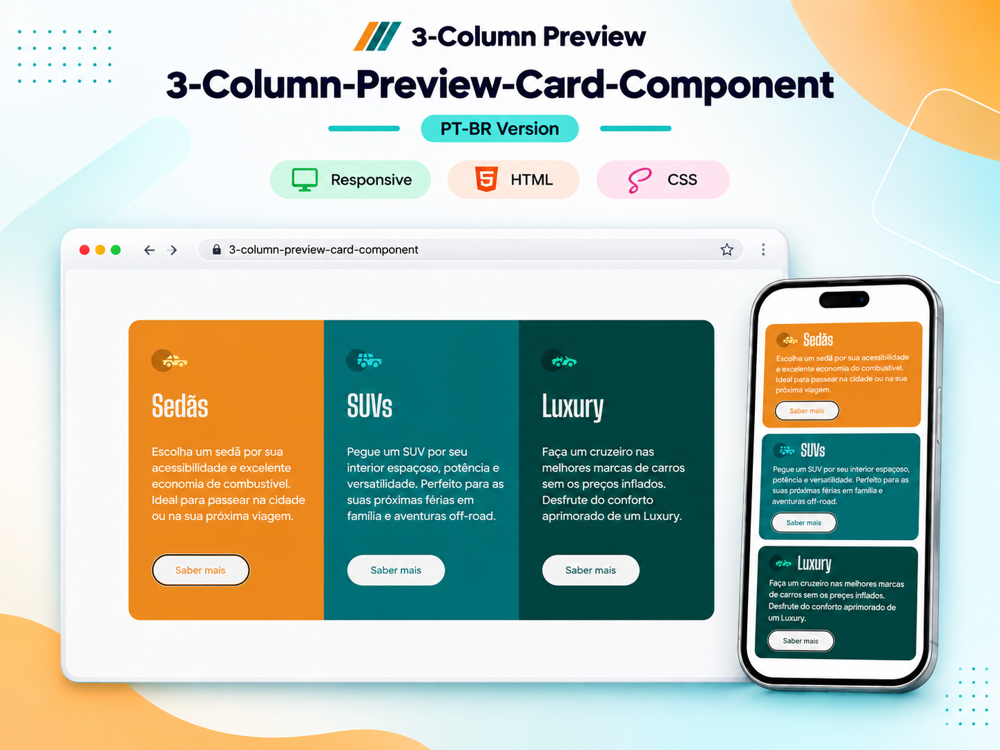

<p align="center">
  
</p>

<h1 align="center">3-Column Preview Card Component — PT-BR</h1>

<p align="center"><strong>A responsive Frontend Mentor challenge adapted into Brazilian Portuguese.</strong></p>

<p align="center">
  
  
  
  
  
</p>

<p align="center">
  <a href="https://gustavovitors.github.io/3-column-preview-card-component/">Live Demo</a> ·
  <a href="https://github.com/GustavoVitorS/3-column-preview-card-component">Source Code</a> ·
  <a href="https://www.frontendmentor.io/">Frontend Mentor</a>
</p>

---

## Overview

This project is my implementation of Frontend Mentor's **3-Column Preview Card Component** challenge, with the card content adapted into **Brazilian Portuguese (PT-BR)**.

The interface features three vehicle categories:

- **Sedãs** — an orange card describing affordability and fuel efficiency.
- **SUVs** — a teal card describing space, versatility, and outdoor travel.
- **Luxury** — a dark-teal card highlighting comfort and a premium experience.

Each card includes a vehicle icon, heading, description, and a **“Saber mais”** button. This is a front-end design exercise rather than a vehicle rental or booking application.

## Project Preview

The banner above presents the existing project in desktop and mobile mockups. It is documentation artwork, **not a redesign or a new feature release**.

[View the full-size showcase image](docs/3-column-preview-showcase.png)

## Features

- **Responsive card layout** designed for desktop and mobile screen sizes.
- **Three distinct card designs** with separate colors and vehicle icons.
- **Brazilian Portuguese text** throughout the component.
- **CSS-styled buttons** labeled “Saber mais”; no JavaScript functionality is attached to them.
- **Static implementation** without a back-end or JavaScript dependencies.

## Technologies

| Technology | Purpose |
| --- | --- |
| **HTML5** | Structure and content of the vehicle cards |
| **SCSS / Sass** | Source stylesheets |
| **CSS3** | Styling loaded from the compiled `dist/main.css` file |
| **Responsive CSS** | Adapting the presentation to different viewport sizes |

The published source uses **HTML, SCSS, and compiled CSS**. There is no JavaScript implementation in the current project.

## Project Structure

```text
3-column-preview-card-component/
├── dist/
│   └── main.css                   # Compiled CSS loaded by index.html
├── images/                        # Vehicle icons and other visual assets
├── scss/                          # SCSS source files
├── docs/                          # Documentation assets (new)
│   └── 3-column-preview-showcase.png
├── index.html                     # Static PT-BR page
└── README.md                      # Project documentation (updated)
```

## Run Locally

**1. Clone the repository:**

```bash
git clone https://github.com/GustavoVitorS/3-column-preview-card-component.git
cd 3-column-preview-card-component
```

**2. Open `index.html`** in your browser, or start an optional local web server:

```bash
python3 -m http.server 8000
```

**3.** Visit [http://localhost:8000](http://localhost:8000) when using the local server.

No package installation or JavaScript build process is needed to view the page. If you modify the SCSS sources, compile them into `dist/main.css` with Sass to update the browser styles.

## Project Links

- **Repository:** [GustavoVitorS/3-column-preview-card-component](https://github.com/GustavoVitorS/3-column-preview-card-component)
- **Live demo:** [GitHub Pages](https://gustavovitors.github.io/3-column-preview-card-component/)
- **Challenge collection:** [Frontend Mentor Challenges — PT-BR](https://github.com/GustavoVitorS/Frontend-mentor-challenges_PT-BR)

## Credits

The original 3-Column Preview Card Component challenge and design were provided by [Frontend Mentor](https://www.frontendmentor.io/). This repository contains my independent implementation and Brazilian Portuguese adaptation for front-end practice.

**Created by [GustavoVitorS](https://github.com/GustavoVitorS).**
